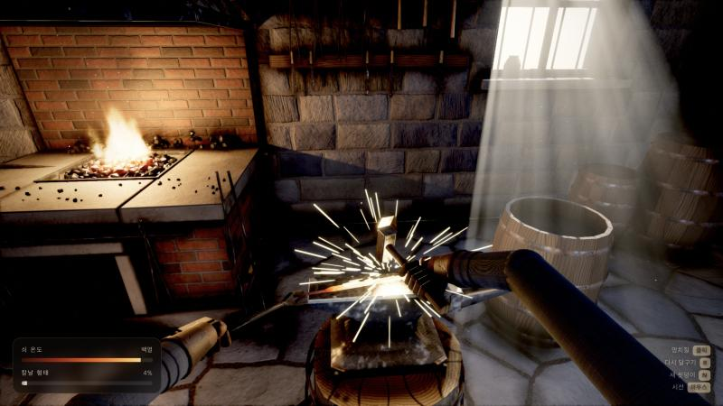

# Emberfall Forge

> 이 저장소의 게임 코드는 Anthropic의 **Claude Fable 5.2**가 작성했습니다.
> 사람은 방향을 정하고 결과를 검토했고, 공개용 정리(이 README 보강·LICENSE)는 **Claude Opus 5.5**가 했습니다.

코드만으로 만든 1인칭 대장간 장면(모루 망치질). 3D 모델·이미지·소리 파일 없이
three.js와 직접 쓴 셰이더로 화면과 소리를 실행 중에 만든다.



## English summary

Emberfall Forge is a first-person blacksmith scene: you hammer a glowing blade on an anvil.
It is built entirely in code with three.js and hand-written shaders. There are no 3D models,
images or audio files; geometry, textures and sound effects are generated at runtime, and the
build is a single self-contained HTML file.

- **Who wrote the code:** Claude Fable 5.2 (Anthropic), reasoning effort xhigh, on 2026-11-11.
  Writing the code took about 42 minutes.
- **Prompt:** coding began with the instruction "xhigh로 시작" ("start with xhigh"), followed by
  "바꿨어, 계속" ("switched it, continue") once the reasoning effort had been raised. The scope
  had been settled in an earlier conversation, which is not included here.
- **Later changes:** after the game was finished, Claude Fable 5.2 also adapted it for posting as a
  claude.ai artifact (an artifact build output, touch input, reduced-motion support, and a fallback
  when pointer lock is unavailable). These changes are not counted in the 42 minutes.
- **Repository preparation:** Claude Opus 5.5 chose the files to publish and wrote the README
  additions, the LICENSE and the `.gitignore`. A person set the direction and reviewed the results.
- **Run it:** `npm install`, then `npm run build`, then open `dist/forge.html` in a browser.
  Move the mouse to look, click to strike, R to reheat, N for a new billet, Esc to pause.
- **License:** MIT. Uses three.js (MIT). This project is not made or endorsed by Anthropic.

## 제작 기록

| 항목 | 내용 |
| --- | --- |
| 모델 | Claude Fable 5.2 (Anthropic) |
| 추론 수준 | xhigh |
| 실행일 | 2026-11-11 |
| 작업 시간 | 약 42분(첫 게임 코드 작성부터 마지막 코드 수정까지) |
| 프롬프트 | 코드 작업을 시작한 지시 원문(아래) |

```text
xhigh로 시작
```

```text
바꿨어, 계속
```

만들 범위는 이 지시 전의 대화에서 정했고, 그 대화는 싣지 않았습니다.
첫 지시 뒤 Fable 5.2는 프로젝트 뼈대(빌드 설정과 확인용 임시 화면)만 만들고 멈췄습니다.
앱에서 추론 수준을 xhigh로 바꾼 뒤 두 번째 지시로 본 작업을 시작했습니다.

게임 완성 뒤에는 claude.ai 아티팩트로 게시하려고 Fable 5.2가 코드를 조금 더 고쳤습니다.
게시용 HTML과 빌드 출력, 터치 망치질, 움직임 줄이기 설정 반영, 마우스 잠금이 막힐 때의
대체 동작입니다. 이 수정은 위 작업 시간에 넣지 않았습니다.

## 역할

| 누가 | 한 일 |
| --- | --- |
| 저장소 소유자(사람) | 기획·지시, 결과 검토 |
| Claude Fable 5.2 | 게임 코드(`src/`), 빌드 스크립트, 스크린샷, 원래 README, 아티팩트 게시용 수정 |
| Claude Opus 5.5 | 공개용 정리: 올릴 파일 선별, 이 README의 제작 기록·역할·영문 요약·고지, LICENSE, `.gitignore` |

커밋 이력도 같은 구분을 따릅니다. 첫 커밋은 Claude Fable 5.2가 만든 파일을 담았고,
두 번째 커밋이 공개용 정리입니다. 각 커밋의 `Co-Authored-By`에 해당 모델이 적혀 있습니다.

## 실행

```bash
npm install
```

```bash
npm run build
```

`dist/forge.html` 하나가 결과물이다(three.js 포함, 외부 요청 없음). 브라우저에서 바로 열면 된다.

같이 만들어지는 `dist/forge-artifact.html`은 claude.ai 아티팩트 게시용이다(문서 뼈대 없이 내용만).

개발 중에는 `npm run dev` 후 `http://localhost:5183` (새로고침마다 최신 소스 반영).
`/dist`는 배포용 번들, `/artifact`는 게시용 파일을 그대로 보여 준다.

## 조작

- 마우스: 시선 / 클릭: 망치질(모루를 보는 지점을 친다)
- R: 다시 달구기 / N: 새 쇳덩이 / Esc: 멈춤

## 구조

- `src/gfx/pipeline.js` 후처리(HDR, AO, 볼류메트릭 빛줄기, 블룸, 톤매핑·색보정, FXAA·그레인)
- `src/tex/` 절차적 재질: GLSL로 표면을 정의하고 GPU에서 텍스처로 굽는다
- `src/geo/builder.js` 지오메트리 도구(모서리 깎은 상자, 자동 UV, 재질별 병합)
- `src/world/` 방·화덕·모루·소품·손·칼날, `src/fx/` 불·불꽃·먼지, `src/audio/` 효과음 합성
- `src/game/forging.js` 망치질 진행, `src/ui/hud.js` 화면 안내

## 점검용 주소 옵션

`?play`(시작 화면 생략) `?view=wide|hands|up|back…` `?debug=ao|vol|bloom|depth` `?off=ao,vol,bloom,fxaa,grain`

## 라이선스와 고지

- 이 저장소의 코드는 [MIT 라이선스](LICENSE)를 따릅니다.
- [three.js](https://github.com/mrdoob/three.js)(MIT, © 2010-2026 three.js authors)를 사용합니다.
  빌드 결과물 `dist/forge.html`에는 three.js가 라이선스 주석 없이 묶이므로, 결과물을 배포할 때는
  three.js 라이선스 문구를 함께 제공해야 합니다.
- 이 프로젝트는 Anthropic이 만들거나 보증한 것이 아닙니다. Claude와 Fable은 제작에 쓴 모델을
  밝히려고 적은 이름입니다.
